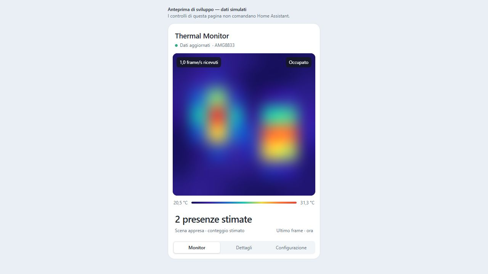

# Thermal Monitor Card

A Home Assistant custom card for the [AMG8833 ESPHome firmware](https://github.com/naamah75/AMG8833-ESPHOME). Draws the 64 temperature pixels directly on a canvas without polling or generating JPEGs.

The approved design has the camera and occupancy estimate in **Monitor**, reference/temperature/offset information in **Dettagli**, and controls in **Configurazione**. Thin, mutually exclusive tab buttons sit at the bottom. UI labels are Italian in this first version.



## HACS installation

In HACS, open **Custom repositories**, add `https://github.com/naamah75/thermal-monitor-card` and select **Dashboard**. Download Thermal Monitor Card, refresh the browser, and add a manual card using [`examples/card.yaml`](examples/card.yaml). Adjust the entity IDs to your ESPHome device. If the resource is not registered automatically, add `/hacsfiles/thermal-monitor-card/thermal-monitor-card.js` as a JavaScript module in Dashboard resources.

The card is available as a custom repository; inclusion in the default HACS catalog requires a separate review.

## Manual installation

1. Copy `dist/thermal-monitor-card.js` to the Home Assistant configuration folder under `www/`.
2. Add a Dashboard resource: `/local/thermal-monitor-card.js?v=0.1.0`, type **JavaScript module**.
3. Add a manual card using `examples/card.yaml`, adjusting entity IDs. Only `entities.pixels` is required; omitted controls are hidden and omitted measurements show a dash.
4. Refresh the dashboard after adding/updating the resource.

Releases include the ready-to-install JavaScript module. No build tools are needed in Home Assistant.

## Pixel sources

Select the **calibrated** 128-byte frame entity for the corrected image. Raw 128-byte frames and the original 64-byte legacy format are also supported. The card preserves negative signed-magnitude temperatures, uses degrees Celsius for pixels, and keeps the square 8×8 field of view without stretching it.

The palette scale can follow the current frame (minimum span 4 °C) or use fixed limits. Interpolation is spatial smoothing, not additional image detail or generated intermediate frames. Reference/offset data and raw temperature statistics are deliberately kept out of Monitor.

## Update rate and unavailable data

- New frame events from Home Assistant trigger decoding and a coalesced canvas redraw; unrelated HA events do not decode/repaint the frame.
- The displayed rate is measured from recent source-state timestamps, not a configured or simulated FPS value.
- There is no private WebSocket, token storage, polling, CDN or runtime dependency. The card uses the existing `hass` connection and state updates.
- Default `stale_after: 8` marks old frames as not updated and hides stale occupancy estimates instead of reporting an empty room. The last image remains under an unavailable overlay.
- An unchanged frame that does not generate a state event cannot be distinguished from a missing update. The firmware currently publishes every second; increasing card repaint frequency cannot create new measurements.

## Controls

- `auto_switch`: `switch.turn_on` / `switch.turn_off`.
- `manual_offset` and `virtual_setpoint`: `number.set_value`, with the entity's advertised numeric limits.
- `learn_scene`: `button.press`, only after confirming that the field of view is empty.

Missing/unavailable entities disable their controls. Failed service calls are shown inside the card. Empty-scene learning is separate from continuous temperature compensation. Virtual reference values simulate a temperature; they do not establish physical calibration accuracy.

Service targets are taken only from explicit configuration. Titles and state values are rendered as text. The card never stores Home Assistant credentials.

## Development

```sh
npm ci
npm run check
npm run demo
```

Node.js 22 or newer is recommended. `npm run build` joins the two source modules into one self-contained file under `dist/`. `npm run demo` serves an isolated preview at `http://127.0.0.1:37993/`; it contains simulated data and never commands HA. Send `stop` on its standard input or stop the process to close it. `happy-dom` is a pinned development-only dependency. Tests cover the actual custom element and pixel decoder: signed/legacy frames, malformed input, stale/unknown occupancy, tabs, exact HA service targets, confirmation, error recovery and timer cleanup.

## Compatibility

Target: Home Assistant 2026.10.x and modern canvas-capable browsers. `ha-card` follows the active HA theme. A YAML configuration is provided; a visual card editor is not included in version 0.1.0.

Companion integration: [Thermal Vision](https://github.com/naamah75/thermal). This card can render ESPHome pixel sensors directly; the companion integration remains useful for the camera entity used elsewhere in HA.

## License

MIT. This is new card code; the separate firmware and integration repositories retain their own licensing.
